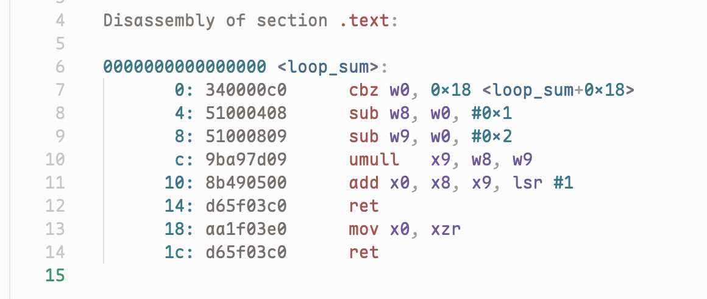

# LLVM Objdump for Zed

Syntax highlighting for `llvm-objdump` disassembly output in [Zed](https://zed.dev).



It highlights:

- file headers (`foo.o: file format elf64-littleaarch64`) and section headers
- symbol labels and references (`<branch_max+0x38>`)
- addresses, with raw instruction bytes dimmed so instructions stand out
- mnemonics, registers, and immediates (`#0x20`, `$0x10`)
- comments: `// ...` (AArch64), `# ...` (x86), and `; ...` source lines from `-S` / `-l`
- relocations from `-r` (`R_AARCH64_CALL26 course_sink`)

It works with AArch64-style 32-bit instruction words (`d10083ff`) and x86-style byte groups (`55 48 89 e5`).

Files ending in `.dis` and `.objdump` are detected automatically. To use it for other files, add them to your Zed `settings.json`:

```json
"file_types": {
  "LLVM Objdump": ["*.asm.txt"]
}
```

## Installation

The extension isn't in the Zed extension registry yet. To install it as a dev extension:

1. Clone this repository.
2. In Zed, run `zed: install dev extension` from the command palette and select the cloned folder.

If it fails to load, run `zed: open log` to see the error.

## Generating the input

```sh
llvm-objdump -d foo.o > foo.dis      # disassembly
llvm-objdump -dr foo.o > foo.dis     # with relocations
llvm-objdump -dS foo.o > foo.dis     # interleaved with source (needs -g)
```

## Limitations

- The grammar targets `llvm-objdump`. GNU `objdump` output is similar but not guaranteed to parse.
- Raw bytes are recognised as even-length hex groups. With `--no-show-raw-insn`, a mnemonic that is entirely hex digits of even length (such as `fadd`) is misread as bytes.
- File paths containing spaces in the header line don't parse.

## Development

```
extension.toml               extension manifest; pins the grammar commit
grammar/grammar.js           tree-sitter grammar
grammar/src/                 generated parser (committed; Zed builds from it)
languages/llvm-objdump/      language config, highlight and bracket queries
```

Changes to files in `languages/llvm-objdump/` only need **Rebuild** in Zed's Extensions panel.

Zed builds the grammar from the commit named in `extension.toml`, not from your working tree. After changing `grammar/grammar.js`:

```sh
cd grammar
npx tree-sitter-cli@0.24.7 generate
npx tree-sitter-cli@0.24.7 parse -q path/to/file.dis   # prints nothing if no errors
```

Then commit and push, set `rev` in `extension.toml` to the new commit hash, and rebuild the extension in Zed.

## License

[MIT](LICENSE)
